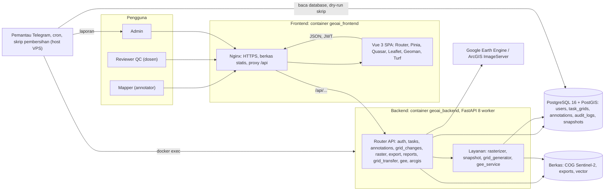
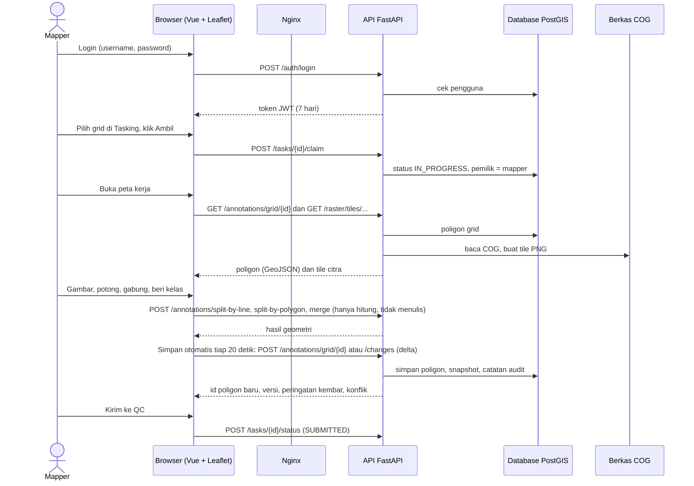
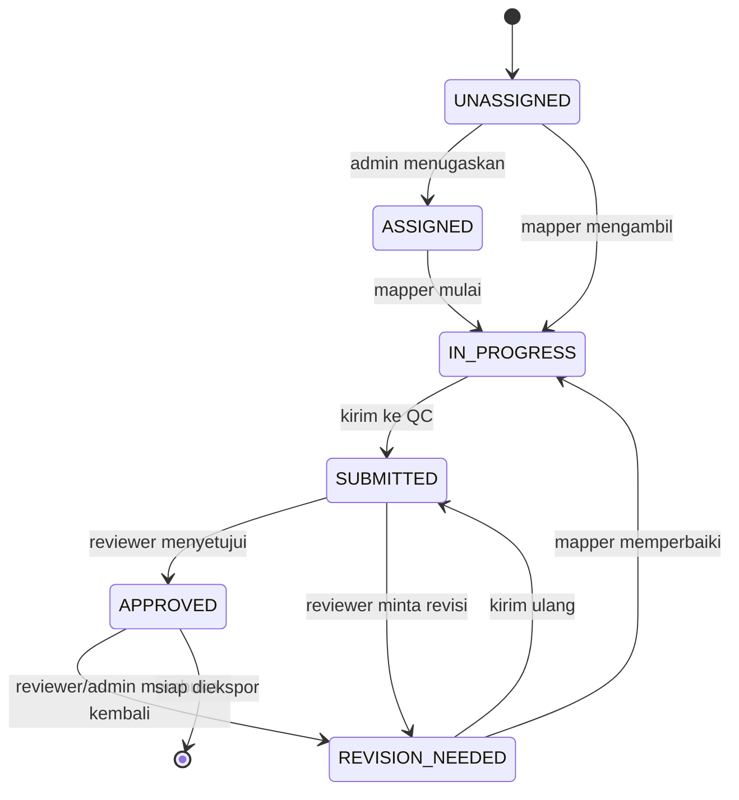
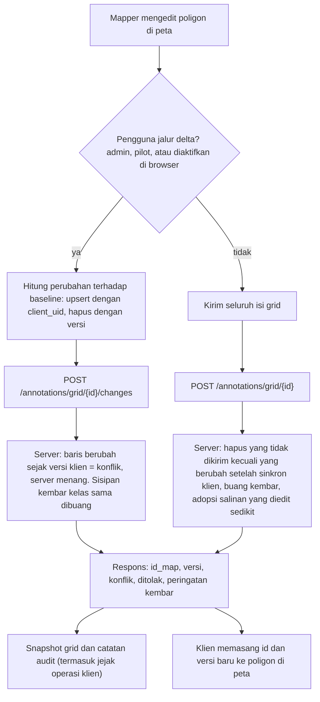

# GEOSTEVIA: arsitektur dan alur proses

Dokumen ini menjelaskan GEOSTEVIA dari sudut pandang pengguna: siapa mengirim apa, diproses oleh bagian mana, disimpan atau
diteruskan ke mana, dan kembali ke pengguna sebagai apa. Disusun supaya bisa ditempel ke Claude, Gemini, atau GPT untuk dibuat
menjadi diagram atau infografik (prompt siap pakai ada di bagian 10).

Dibuat dari pembacaan kode repo pada 24 Oktober 2026. Yang tidak saya verifikasi di produksi ditandai **(belum diverifikasi)**.

## 1. Ringkasan

GEOSTEVIA adalah aplikasi web kolaboratif untuk **membuat data latih tutupan lahan** dari citra satelit Sentinel-2. Wilayah dibagi
menjadi **grid** (petak 256 x 256 piksel, 10 m per piksel, sekitar 2,56 km per sisi). Setiap grid dikerjakan seorang mapper: ia
menggambar poligon di atas citra dan memberi tiap poligon satu dari 14 kelas tutupan lahan (0 sampai 13). Hasilnya diperiksa oleh
reviewer (QC), lalu grid yang disetujui diekspor menjadi **dataset U-Net** (gambar + mask), atau menjadi GeoJSON dan Shapefile.

## 2. Komponen dan tumpukan teknologi

| Lapisan | Komponen | Teknologi | Tugas |
|---|---|---|---|
| Pengguna | Browser mapper, reviewer, admin | Browser modern | Menggambar, memeriksa, mengelola |
| Frontend | Nginx (container `geoai_frontend`) | Nginx, HTTPS (Let's Encrypt) | Melayani berkas statis, mengarahkan `/api/` ke backend, batas unggah 100 MB, jeda baca 300 detik |
| Frontend | Aplikasi satu halaman | Vue 3, Vue Router, Pinia, Vite 5, Quasar 2, Tailwind (lewat CDN), axios | Halaman, status aplikasi, panggilan API |
| Frontend | Peta dan alat gambar | Leaflet 1.9, Leaflet-Geoman (gambar dan edit), Turf.js 7 dan polygon-clipping (hitung geometri di browser), esri-leaflet (layer ArcGIS) | Menampilkan citra, menggambar dan mengedit poligon |
| Frontend | Penyimpanan di browser | `offlineStorage.js` (draf lokal), `deltaSave.js`, `saveContext.js` | Draf offline, penghitung perubahan untuk simpan delta, jejak operasi |
| Backend | Layanan API (container `geoai_backend`) | Python, FastAPI, Uvicorn 8 worker, Pydantic 2 | Semua logika dan endpoint `/api/v1/...` |
| Backend | Data dan geometri | SQLAlchemy 2, GeoAlchemy2, psycopg, Shapely 2, GeoPandas, pyproj, NumPy | Akses database, hitung geometri, ubah koordinat |
| Backend | Raster | Rasterio, Pillow | Membaca GeoTIFF/COG, membuat tile PNG dan mask |
| Backend | Keamanan | python-jose (JWT HS256, masa berlaku 7 hari), passlib + bcrypt | Login dan hak akses |
| Backend | Ekspor laporan | openpyxl, GeoPandas | Excel, CSV, GeoJSON, Shapefile |
| Database | Container `geoai_postgis` | PostgreSQL 16 + PostGIS 3.4 | Menyimpan semua data. Geometri poligon disimpan sebagai **teks GeoJSON** di kolom `geom_geojson` |
| Berkas | Volume di server | COG Sentinel-2 per tahun (`data/raster`), `exports`, `data/vector` | Citra sumber, hasil ekspor |
| Layanan luar | Google Earth Engine, ArcGIS ImageServer | `earthengine-api`, token ArcGIS | Layer citra tambahan **(belum diverifikasi apakah dipakai di produksi)** |
| Operasional | Pemantau dan skrip | Cron di host VPS, bot Telegram, skrip `backend/scripts/` | Laporan kesehatan data 3x sehari, `/periksa`, `/fix` (hanya dry-run), pembersihan data |

## 3. Peran pengguna

| Peran | Bisa apa |
|---|---|
| `annotator` (mapper) | Mengambil (claim) grid yang belum dikerjakan, menggambar, menyimpan, mengirim ke QC, mengunduh/mengunggah Shapefile grid sendiri |
| `dosen` (reviewer QC) | Memeriksa grid yang dikirim, menaruh penanda review (pin) dan catatan, menyetujui atau meminta revisi, membuka kembali grid yang disetujui |
| `admin` | Semua yang di atas, ditambah kelola pengguna dan proyek, impor grid, menetapkan penugasan, ekspor dataset, laporan progres |

Halaman: `/` landing, `/projects` dan `/explore` jelajah proyek, `/login`, `/dashboard`, `/tasking` (daftar dan klaim grid), `/map` (peta kerja),
`/qc` (reviewer), `/admin` (admin), `/export` (ekspor dataset), `/rekap` (laporan progres).

## 4. Diagram arsitektur

## 5. Alur utama pekerjaan mapper

## 6. Siklus status grid

Grid berstatus SUBMITTED atau APPROVED tidak bisa diedit oleh mapper. Tahap QC1, QC2, dan finishing dicatat sebagai tanda terpisah per grid.

## 7. Dua jalur simpan

## 8. Masukan, proses, tujuan, keluaran

| Fitur | Pengguna mengirim | Diproses oleh | Disimpan atau diteruskan ke | Pengguna menerima |
|---|---|---|---|---|
| Login | username dan password | `auth.py`, bcrypt, JWT | tabel `users` | token JWT dan peran |
| Jelajah dan klaim grid | filter proyek, klik "Ambil" | `tasks.py` | `task_grids` (pemilik, status) | daftar grid dan statusnya |
| Citra di peta | pergerakan dan zoom peta | `raster.py`: baca COG, regangkan warna, gamma | cache tile di disk | tile PNG 256 x 256 per tahun |
| Layer tambahan | pilih layer | `gee.py`, `arcgis.py` **(belum diverifikasi di produksi)** | layanan luar | tile atau token layer |
| Menggambar dan potong | garis atau area pemotong | `annotations.py` (`split-by-line`, `split-by-polygon`, `merge`), Shapely | tidak menulis, hanya menghitung | geometri hasil potong atau gabung |
| Beri kelas | pilih kelas 0 sampai 13 | klien, lalu simpan | `annotations.class_id` | poligon berwarna |
| Simpan | poligon (penuh atau perubahan) dan jejak operasi | `annotations.py`, `grid_changes.py` | `annotations`, `grid_snapshots`, `audit_logs` | id poligon, versi, konflik, peringatan kembar |
| Perbaikan topologi | klik Cek Topologi, Auto-heal, Isi celah, Bersihkan sliver | `annotations.py` | `annotations` | laporan celah, lubang, tumpang tindih |
| Riwayat | buka riwayat | `snapshot_service.py` | `grid_snapshots` | daftar versi dan pemulihan |
| Kirim ke QC | tombol Kirim Review | `tasks.py` (aturan transisi status) | `task_grids.status` | status SUBMITTED |
| Review | pin di peta, catatan, setujui atau revisi | `tasks.py` (pin, status) | `task_review_pins`, `reviewer_notes`, `qc1/qc2/finishing` | status APPROVED atau REVISION_NEEDED beserta catatan |
| Laporan progres | buka rekap | `reports.py` | tabel `task_grids` | tabel progres, unduhan Excel atau CSV |
| Transfer grid | unduh atau unggah Shapefile | `grid_transfer.py` (Shapefile, raster terpotong, pratinjau dry-run) | `annotations` | `.zip` Shapefile, COG per grid, atau laporan pratinjau impor |
| Ekspor dataset | klik Ekspor | `export_dataset.py`, `rasterizer.py` | `export_jobs`, folder `exports` | `.zip` dataset U-Net lewat unduhan job |
| Ekspor vektor | pilih GeoJSON atau Shapefile | `export_dataset.py` | langsung | berkas GeoJSON atau `.zip` Shapefile, ringkasan |
| Kelola pengguna dan proyek | form admin | `auth.py`, `tasks.py` | `users`, `study_areas`, `task_grids` | daftar terbarui |

## 9. Keluaran sistem

1. **Dataset U-Net** (`.zip`): `train/`, `val/`, `test/`, masing-masing berisi `images/` (GeoTIFF multi-kanal atau pratinjau RGB),
   `masks/` (label bulat per piksel), dan `masks_color/` (visual berwarna). Ditambah `metadata.json`, `classes.json`, dan
   `class_distribution.json`. Mask berukuran 256 x 256, nilai kelas 0 sampai 12.
2. **Data vektor**: GeoJSON dan Shapefile poligon tutupan lahan (atribut kelas), dan ringkasan jumlah.
3. **Berkas per grid untuk kerja offline**: Shapefile poligon grid dan COG Sentinel-2 yang dipotong sesuai grid.
4. **Laporan progres**: tabel di layar, Excel, dan CSV.
5. **Jejak dan cadangan di server**: `audit_logs`, `grid_snapshots` (riwayat dan pemulihan), cadangan `pg_dump`.
6. **Laporan kesehatan data ke Telegram**: tiga kali sehari, ditambah `/periksa` sesuai permintaan.

## 10. Model data inti

| Tabel | Isi utama |
|---|---|
| `users` | akun, peran (`admin`, `dosen`, `annotator`) |
| `study_areas` | proyek atau wilayah studi |
| `task_grids` | satu baris per grid: kode (`SB_GRID_xxx_tahun`), tahun, kotak batas, poligon grid, pemilik, status, catatan reviewer, tanda QC |
| `annotations` | satu baris per poligon: grid, kelas, `geom_geojson` (teks), luas, pembuat, `created_at`, `updated_at`, `client_uid` |
| `task_review_pins` | penanda review reviewer di peta |
| `land_cover_classes` | 14 kelas (0 Belum Teridentifikasi, 1 Hutan Lahan Kering, ..., 12 Tambak Pesisir, 13 Di Luar Wilayah Sampel) |
| `grid_snapshots` | salinan seluruh poligon grid pada waktu tertentu (riwayat) |
| `audit_logs` | catatan aksi: simpan, kembar mencurigakan, hasil skrip pembersihan |
| `export_jobs` | pekerjaan ekspor dataset |

Hubungan: `study_areas` 1-N `task_grids` 1-N `annotations`; `task_grids` 1-N `task_review_pins` dan `grid_snapshots`; `users` 1-N `task_grids` (pemilik).

## 11. Prompt siap pakai untuk visualisasi

Tempel dokumen ini lalu tambahkan salah satu prompt di bawah.

**A. Diagram yang akurat (Claude atau GPT, keluaran Mermaid atau draw.io)**

> Dari dokumen ini, buat satu diagram arsitektur berlapis (Pengguna, Frontend, Backend, Database dan Berkas, Layanan luar, Operasional)
> dengan panah bertanda isi data yang lewat. Pakai hanya komponen dan istilah dari dokumen, jangan menambah komponen. Keluarkan sebagai
> kode Mermaid yang valid, lalu satu diagram urutan untuk "mapper mengambil grid, menggambar, menyimpan, mengirim ke QC".

**B. Infografik bergaya poster (Gemini "nano banana" atau generator gambar GPT)**

> Buat infografik horizontal berjudul "Alur GEOSTEVIA" dengan latar terang dan palet biru-hijau. Tampilkan empat jalur dari kiri ke
> kanan: (1) Pengguna: mapper, reviewer, admin; (2) Frontend: Nginx dan aplikasi Vue dengan peta; (3) Backend: FastAPI dan layanan
> raster; (4) Penyimpanan: PostgreSQL PostGIS dan berkas citra COG. Beri panah bernomor: 1 login, 2 ambil grid, 3 citra Sentinel-2
> menjadi tile, 4 gambar dan beri kelas poligon, 5 simpan otomatis tiap 20 detik, 6 kirim QC, 7 setujui, 8 ekspor dataset U-Net.
> Di ujung kanan tampilkan keluaran: dataset U-Net (gambar dan mask), GeoJSON, Shapefile, laporan Excel. Pakai ikon sederhana, teks
> pendek berbahasa Indonesia, maksimal 25 label, tanpa paragraf.

Saran: generator gambar sering salah mengeja teks panjang. Untuk akurasi, buat dulu diagramnya dengan prompt A, lalu pakai prompt B
hanya untuk tampilan akhir dengan label yang singkat.

## 12. Batasan dokumen ini

- Dibuat dari kode, bukan dari pemakaian langsung semua halaman. Perilaku antarmuka yang tidak terbaca dari kode bisa terlewat.
- Peran `dosen`, `reviewer`, dan `supervisi` muncul di pemeriksaan hak di kode; dokumen menyamakan reviewer QC dengan peran `dosen` dan admin.
- Pemakaian Google Earth Engine dan ArcGIS di produksi belum diverifikasi, meski endpoint-nya ada.
- Konfigurasi `docker-compose.prod.yml` memuat nilai bawaan untuk kata sandi database dan `SECRET_KEY` bila variabel lingkungan tidak diisi, dan CORS
  backend mengizinkan semua asal. Saya belum memeriksa apakah produksi mengisi variabel itu. Layak dicek terpisah.
- Untuk cara kerja simpan, audit, dan perbaikan data lihat `docs/RUNBOOK_SIMPAN_DAN_PERBAIKAN.md`.
